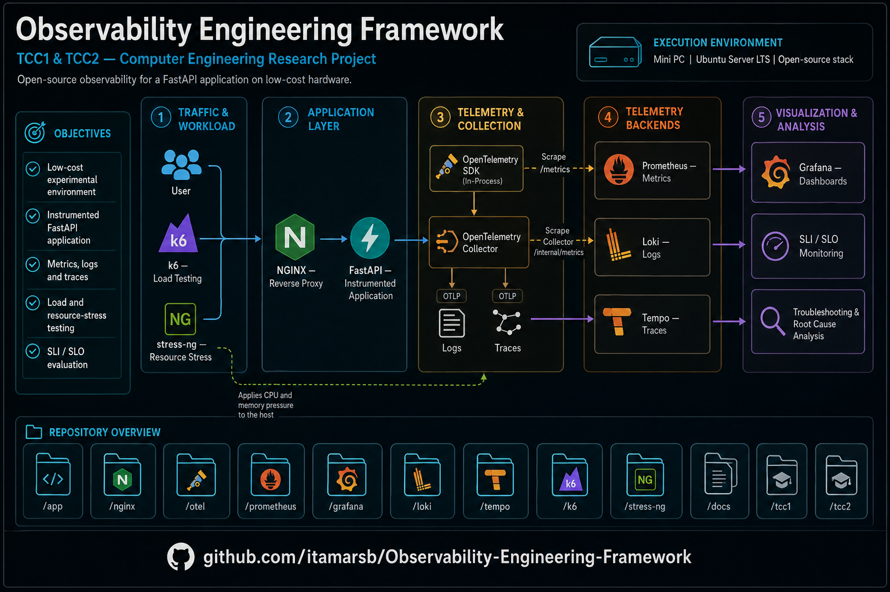
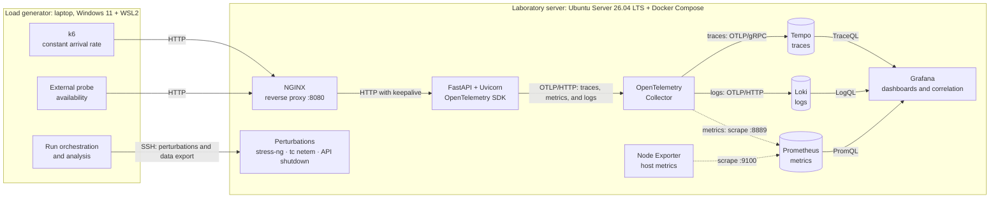

<div align="center">



<sub>Illustrative overview. The implemented telemetry flow is described in <a href="#architecture">Architecture</a>.</sub>

# Observability Engineering Framework

**Open-source observability laboratory for metrics, logs, and traces, with controlled workload and perturbation experiments on low-cost hardware.**

</div>

**Language:** [Português (Brasil)](README.md) | **English (US)**

---

## About the Project

The Observability Engineering Framework is the undergraduate capstone project (Trabalho de Conclusão de Curso, or TCC) for a bachelor's degree in Computer Engineering.

The objective is to design, implement, and evaluate an observability environment built exclusively with open-source technologies and low-cost hardware, assessing the extent to which it provides sufficient information to **detect, investigate, and interpret** changes in application behavior under normal operating conditions, at different workload levels, and under controlled stress conditions.

The system under observation is an API developed with FastAPI and exposed through NGINX. Metrics, logs, and traces are produced with OpenTelemetry and handled by the OpenTelemetry Collector, Prometheus, Loki, Tempo, and Grafana. All services run with Docker Compose on a single laboratory server. A separate laptop generates workloads with k6 and measures the service externally.

> This repository is under development. Items marked as *pending* or *planned* are not yet operational, and no experimental results have been published to date.

---

## Current Status

*Last updated: October 16, 2026.*

| Item | Status |
|:---:|:---:|
| Ubuntu Server 26.04 LTS installed on the laboratory server | Completed |
| Wi-Fi network, static IP address, and SSH access | Completed |
| System updates | Completed |
| Dedicated wired network between the laptop and server | In progress |
| Docker Engine and Docker Compose on the server | Pending |
| Application, NGINX, and observability stack (code and configuration) | Version-controlled; server validation pending |
| Grafana data sources and dashboards (provisioned as code) | Version-controlled; server validation pending |
| k6 workloads and perturbation scripts | Version-controlled; pilot runs pending |
| Orchestration, export, and analysis scripts | Version-controlled; pilot runs pending |
| Pilot runs and protocol freeze | Planned |
| Experimental campaign | Planned |
| Analysis and final documentation | Planned |

---

## Objectives

### General Objective

Develop and validate an open-source observability framework that integrates telemetry, storage, and visualization tools to analyze the performance and reliability of a back-end application.

### Specific Objectives

- Configure an experimental environment based on low-cost hardware and the Ubuntu Server LTS Linux operating system.
- Develop and instrument a back-end application using FastAPI and OpenTelemetry.
- Integrate Prometheus, Grafana, Loki, and Tempo for the collection, processing, and analysis of telemetry signals.
- Conduct load tests with k6 and controlled perturbation experiments (chaos engineering) targeting CPU, memory, and network resources using stress-ng and tc netem.
- Evaluate system behavior against predefined service level indicators (SLIs) and service level objectives (SLOs).

### Validation Criteria

The framework is considered validated only if verifiable evidence demonstrates that:

- the application responds correctly under normal conditions;
- OpenTelemetry produces and exports metrics, logs, and traces;
- Prometheus, Loki, and Tempo receive their respective signals and make them available for querying;
- Grafana provides access to information from the different back ends;
- k6 delivers the planned workload without dropped iterations and enables latency, throughput, and errors to be calculated for each scenario;
- perturbations produce identifiable changes in CPU or memory consumption or in network behavior;
- the same `trace_id` links a log entry to the trace of the corresponding request;
- SLIs can be calculated and compared against the defined SLOs;
- third parties can deploy the environment using this repository and its step-by-step documentation.

---

## Architecture



Solid arrows represent requests and telemetry sent by their producers (HTTP and OTLP), as well as data retrieved by Grafana from each back end (PromQL, LogQL, and TraceQL). Dashed arrows represent metrics collected by Prometheus through scraping. Prometheus does not receive logs or traces. Perturbations affect the host CPU and memory (scenarios C4 and C5), the NGINX container's network (C6), or the API container (C7). These scenarios are described in [Experimental Design](#experimental-design).

Detailed diagrams of the topology, telemetry pipeline, request flow, run orchestration, and evaluation stages are available in [`docs/architecture/`](docs/architecture/README.en.md).

| Address | Service | Access |
|:---:|:---:|:---:|
| `LAB_BIND_IP:8080` | NGINX, single entry point | Load generator and probe through the dedicated laboratory network |
| `127.0.0.1:3000` / `9090` / `3100` / `3200` | Grafana / Prometheus / Loki / Tempo | Server only; accessible from the laptop through an SSH tunnel |
| Host network `:9100` | Node Exporter | Scraped by Prometheus; because it uses `network_mode: host`, firewall and bind settings must be verified before connecting to non-isolated networks |
| `collector:4318`, `tempo:4317` | OTLP | Internal Compose network only |

---

## Telemetry Signals

| Signal | Source | Path | Storage and Querying |
|:---:|:---:|:---:|:---:|
| Traces | Server span for each request (FastAPI instrumentation) and child spans `validar_entrada` and `calcular_hash` | OTLP/HTTP → Collector → OTLP/gRPC | Tempo, TraceQL |
| Application metrics | `http.server.request.duration` histogram (stable HTTP semantic conventions) | OTLP/HTTP → Collector → Prometheus exporter (scraped every 5 s) | Prometheus, PromQL |
| Host metrics | Node Exporter: CPU, memory, disk, network, and temperature | Scraped every 5 s | Prometheus, PromQL |
| Pipeline health | Internal Collector metrics and Prometheus, Loki, and Tempo target metrics | Scraped every 5 s | Prometheus, PromQL |
| Application logs | Structured `request_completed` event (route, status, duration, `run_id`) with `trace_id` and `span_id` | OTLP/HTTP → Collector → Loki OTLP endpoint | Loki, LogQL |
| Proxy logs | NGINX JSON access log (`request_time`, upstream timings, `run_id`) | Container output, exported for each run | Run files |

**Correlation.** Each application log carries the `trace_id` of its request. A Grafana derived field opens the corresponding trace in Tempo, and Tempo links back to the logs associated with that trace. Each run sends the `X-Run-ID` header, which is recorded as a span and log attribute, but never as a metric label, to prevent cardinality growth. Traces are sampled at 100%.

**Dashboards** (provisioned from [`config/grafana/dashboards/`](config/grafana/dashboards/)):

1. HTTP service (server-side view): throughput, P95/P99 latency, 5xx responses, and requests by status code.
2. Server resources: CPU, memory, load, network traffic, and temperature.
3. Telemetry health: scraped targets and items accepted, rejected, and queued by the Collector.
4. Investigation: application events and traces filtered by `run_id`.

---

## Experimental Application

| Route | Behavior | Use |
|:---:|:---:|:---:|
| `GET /health` | `200 {"status":"ok"}`; excluded from telemetry | Container health check |
| `GET /work?n=20000` | Validates `1 ≤ n ≤ 100000` and applies SHA-256 `n` times starting from a fixed seed; returns `n` and `digest` | Representative operation for load testing, probing, and SLIs |
| `GET /controlled-error` | `503` with an error log and span, only when `ENABLE_TEST_ROUTES=true` (otherwise, `404`) | Correlation verification; disabled during the campaign |

The computation is deterministic: the expected digest is calculated outside the server ([`scripts/expected_digest.py`](scripts/expected_digest.py)), and a request is counted as successful only when it returns status 200 **and** the correct content.

---

## SLIs and SLO Targets

| SLI | Source | Definition |
|:---:|:---:|:---:|
| P95 and P99 latency | k6 (client side) | Percentile calculated using the nearest-rank method, based only on correct responses |
| Composite error rate | k6 | Failed attempts divided by total attempts; a failure is a status other than 200, an incorrect body, a timeout, or a connection error |
| Successful throughput | k6 | Correct responses per second, compared against the offered arrival rate |
| Sampled availability | External probe | Successful probes divided by total probes, evaluated only when probe coverage is 100% |

Targets are recorded in [`experiments/scenarios/protocol-v1.md`](experiments/scenarios/protocol-v1.md) **before** the campaign and are not changed after the results are known:

- composite error rate ≤ 1%;
- sampled availability ≥ 99% in each measurement window;
- successful throughput ≥ 95% of the offered arrival rate;
- P95 and P99 latency targets derived from the C0 pilot (proposed rule: twice the value measured during the pilot, rounded up to the next multiple of 25 ms).

CPU and memory utilization are treated as resource metrics that help explain the results, rather than as SLOs. Server-side percentiles calculated from Prometheus histograms are estimates; the client is the primary source of latency measurements.

These are experimental targets for a laboratory environment, not production guarantees or service level agreements (SLAs).

---

## Experimental Design

Experimental scenarios are identified as C0 through C7 (C1, the low-load scenario, was removed from the scope). The same numbering is used in parameter files ([`experiments/scenarios/`](experiments/scenarios/)), run identifiers, and result tables.

| ID | Scenario | Offered Load | Perturbation |
|:---:|:---:|:---:|:---:|
| C0 | Baseline | R0, approximately 20–25% of measured capacity | None |
| C2 | Medium load | Approximately 40–50% of capacity | None |
| C3 | High load | Approximately 70–80% of capacity | None |
| C4 | CPU contention | R0 | `stress-ng` across all host CPU threads |
| C5 | Memory pressure | R0 | `stress-ng --vm` under the systemd `MemoryMax` limit |
| C6 | Network delay | R0 | `tc netem` delay on the NGINX container's network interface |
| C7 | Controlled API failure (optional) | R0 | API container stopped for 60 s and then restarted |

R0 is the reference workload: the same arrival rate used in C0 is applied to scenarios C4 through C7, so that the perturbation is the only difference from the baseline.

Server capacity is measured before the scenarios using a stepped load ramp ([`experiments/k6/ramp.js`](experiments/k6/ramp.js)). Workload levels, perturbation intensities, and targets are calibrated during the pilot runs and then frozen. See [`experiments/experimental-matrix.en.md`](experiments/experimental-matrix.en.md) for details.

Methodological safeguards:

- **Baseline:** recorded before the remaining scenarios.
- **Repetition:** three valid runs per scenario, across three blocks with alternating execution order.
- **Fixed windows:** 60 s of warm-up and 180 s phases; perturbation scenarios have *before*, *during*, and *after* phases.
- **Open workload model:** constant arrival rate (requests per second); virtual users represent only the load generator's capacity.
- **External measurement:** the load generator and probe run outside the server, so measurement continues even when the API or telemetry pipeline degrades.
- **Time synchronization:** the server uses UTC with chrony; the clock offset between the laptop and server is measured for every run.
- **Reproducibility:** pinned versions, configuration as code, and a protocol frozen with a Git tag before the campaign.
- **Data integrity:** raw data from each run is retained with SHA-256 checksums; invalid runs are preserved and labeled, never deleted.
- **Pilot data is never presented as experimental campaign results.**

---

## Experimental Environment

| Component | Description |
|:---:|:---:|
| Laboratory server | Low-cost computer marketed as a “Mini PC”: Intel Core i7-2600 (4 cores, 8 threads), B75 motherboard, 16 GB of RAM, 480 GB SSD. |
| Operating system | Ubuntu Server 26.04 LTS (kernel 7.0), on a dedicated partition (dual boot). |
| Load generator | Laptop with Windows 11 and WSL2 (Ubuntu), running k6, the probe, and the analysis tools. |
| Network | Dedicated Ethernet link between the laptop and server (`10.10.10.0/24`, no gateway); Wi-Fi is used only for internet access and updates. |

### Pinned Versions

| Component | Version | Component | Version |
|:---:|:---:|:---:|:---:|
| OpenTelemetry Collector (contrib) | 0.162.0 | Python base image | 3.12-slim |
| Prometheus | 3.15.0 | FastAPI / Starlette / Uvicorn | 0.141.1 / 1.6.0 / 0.53.0 |
| Loki | 3.7.8 | OpenTelemetry Python SDK / instrumentation | 1.45.1 / 0.66b1 |
| Tempo | 3.1.0 | k6 | 2.3.0 |
| Grafana | 13.1.3 | Node Exporter | 1.12.1 |
| NGINX | 1.30.5 | | |

Image digests and the complete dependency lock file (`app/requirements.lock`) are recorded after the first build on the laboratory server.

Installation evidence: [Ubuntu Server installation notes](docs/lab-notes/ubuntu-server-installation.md).

---

## How to Run

Server requirements: Ubuntu Server LTS, Git, Docker Engine, and the Docker Compose plugin.

```bash
git clone https://github.com/itamarsb/Observability-Engineering-Framework.git
cd Observability-Engineering-Framework

cp .env.example .env && chmod 600 .env   # set GRAFANA_ADMIN_PASSWORD, APP_VERSION, and LAB_BIND_IP
docker compose config -q                 # validate compose.yaml

docker compose build api
docker compose up -d api nginx
docker compose up -d prometheus loki tempo grafana
docker compose up -d collector node-exporter
docker compose ps
```

- Complete, ordered procedure: [`docs/runbooks/deployment.en.md`](docs/runbooks/deployment.en.md).
- Before the campaign, consult the [repository audit](docs/runbooks/auditoria-repositorio-2026-10-20.md) and the [pre-pilot verification checklist](docs/runbooks/verificacao-v4.md).
- **Results:** the `consolidate.py` script includes only runs with `- Classificacao final: VALIDA` in `notes.md`, after human review against the protocol criteria.

- To access Grafana from the laptop, run `ssh -N -L 3000:127.0.0.1:3000 <usuario>@<servidor>` and open `http://localhost:3000`. Replace `<usuario>` and `<servidor>` with the SSH username and server address.
- To stop the stack, use `docker compose stop`. Do **not** use `docker compose down -v`, which deletes telemetry volumes.

Run a scenario from the laptop (WSL2, with k6 2.3.0, Python 3, and key-based SSH access to the server):

```bash
scripts/run_scenario.sh C0 r01 pilot
```

For the capacity ramp (pilot runs) and the complete campaign, including figures and tables generated from raw data, see [`results/README.md`](results/README.md).

```bash
scripts/run_ramp.sh                              # ramp + Figure C10
python3 scripts/calibrar_taxas.py --aplicar      # scenario arrival rates based on the ramp
python3 scripts/derive_slo.py runs/pilot --gravar  # targets based on C0 pilots
python3 scripts/run_campaign.py                  # 3 blocks × 6 scenarios, resumable
python3 scripts/revisar_execucoes.py --aplicar   # classification against protocol criteria
python3 scripts/gerar_resultados.py              # figures and tables for the paper
```

> The procedures above are undergoing validation on the laboratory server and may be adjusted during the pilot runs.

---

## Repository Structure

```text
Observability-Engineering-Framework/
├── README.md                # primary documentation in Brazilian Portuguese
├── README.en.md             # US English documentation
├── app/                     # FastAPI application, OpenTelemetry configuration, Dockerfile
├── config/
│   ├── grafana/             # data sources and dashboards provisioned as code
│   ├── loki/
│   ├── nginx/
│   ├── otel-collector/      # normal pipelines and debug-only configuration
│   ├── prometheus/
│   └── tempo/
├── docs/
│   ├── architecture/        # architecture and flow diagrams (Mermaid)
│   ├── images/              # cover image and installation photos
│   ├── lab-notes/           # installation records
│   ├── runbooks/            # deployment procedure
│   └── templates/           # logbook and environment record templates
├── experiments/
│   ├── k6/                  # constant-arrival-rate workload and capacity ramp
│   ├── scenarios/           # C0–C7 parameters and experimental protocol
│   ├── stress-ng/           # perturbation scripts: CPU, memory, network, and API shutdown
│   └── experimental-matrix.md
├── results/                 # consolidated summaries and evidence index
├── scripts/                 # orchestration, probing, export, analysis, and plots
├── tcc/                     # academic documents, after final assessment
├── compose.yaml
├── .env.example
├── CITATION.cff
└── LICENSE
```

---

## Roadmap

### Completed

- [x] Install Ubuntu Server 26.04 LTS on the laboratory server.
- [x] Configure network access, a static IP address, and SSH.
- [x] Install operating system updates.
- [x] Create the repository structure and metadata.
- [x] Place the application, Docker Compose stack, configurations, workloads, and analysis scripts under version control.
- [x] Align the documentation with the Docker Compose design.

### Implementation and Evaluation Stages

- [ ] **Stage 0** — Access verification, server and laptop inventory, backup.
- [ ] **Stage 1** — Dedicated wired network, UTC clock with chrony, Docker Engine and Compose.
- [ ] **Stage 2** — Same commit on the server and load generator; local `.env` file.
- [ ] **Stage 3** — API behind NGINX; functional tests; dependency lock file.
- [ ] **Stage 4A** — Instrumentation verified using the Collector debug exporter.
- [ ] **Stage 4B** — Prometheus, Loki, Tempo, and Grafana integrated; log-to-trace correlation verified.
- [ ] **Stage 5** — Dashboards, queries, and data export verified.
- [ ] **Stage 6** — Pilot runs: capacity ramp, workload calibration, targets, and safe perturbation limits.
- [ ] **Stage 7** — Freeze protocol v1 (commit and `protocolo-v1` tag).
- [ ] **Stage 8** — Campaign: scenarios C0 and C2 through C6 (and C7, if retained), three repetitions each.
- [ ] **Stage 9** — Analysis: SLIs against SLOs, tables, figures, and investigation.
- [ ] **Stage 10** — Evidence index, final figures, and release tag.

---

## Results

No experimental results have been published to date. The organization of run data, summaries, and evidence is described in [`results/README.md`](results/README.md).

---

## Known Limitations

- Single-node environment, which does not represent distributed enterprise infrastructure.
- The laboratory server uses a dual-boot configuration, and the load generator is a laptop running WSL2.
- Telemetry collection consumes resources on the system under observation.
- FastAPI is pinned to a version predating its native OpenTelemetry support to keep the instrumentation design stable throughout the project.
- Independent reproduction is outside the scope of the project; the procedure is documented step by step so that third parties can reproduce it.

---

## Security Notes

- NGINX is the only application HTTP port intentionally exposed on the dedicated network. **Exception to verify:** Node Exporter uses `network_mode: host` and may listen on port `9100` on physical interfaces. Verify firewall and listening settings before using external networks. The Grafana, Prometheus, Loki, and Tempo interfaces are restricted to `127.0.0.1` and accessed through an SSH tunnel.
- The `.env` file, keys, raw run data, and telemetry volumes are not committed to version control.
- Logs and span attributes do not contain personal or sensitive data.

---

## Academic Context

This repository supports the undergraduate capstone project (Trabalho de Conclusão de Curso, or TCC) for a bachelor's degree in Computer Engineering. The project is developed in two stages: TCC1 (research proposal, completed) and TCC2 (implementation and evaluation, in progress).

Source code, configuration files, experimental procedures, and documentation are maintained here to support technical review, reproducibility, portfolio presentation, and future research. Academic documents will be added to the [`tcc/`](tcc/) directory after the final assessment.

To cite this project in academic or technical work, refer to the metadata in [`CITATION.cff`](CITATION.cff).

---

## License

This project is distributed under the [MIT License](LICENSE).

Copyright © 2026 Itamar de Sá Britto Júnior.

---

## 📈 Repository Metrics

<p align="center">

<a href="https://info.flagcounter.com/A1ey"></a>

</p>
