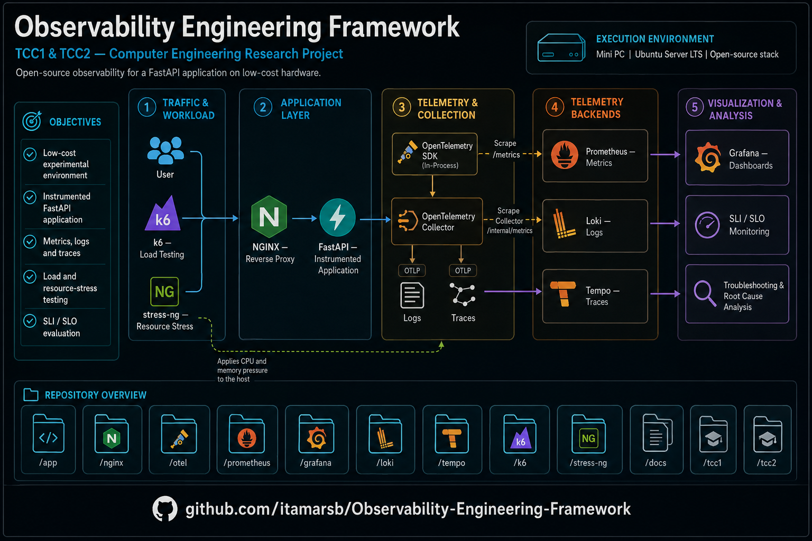
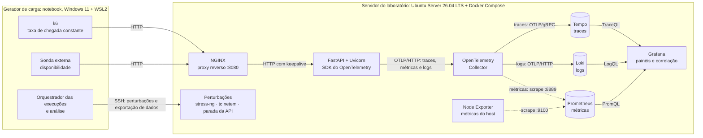

<div align="center">



<sub>Visão ilustrativa. O fluxo de telemetria implementado está descrito em <a href="#arquitetura">Arquitetura</a>.</sub>

# Observability Engineering Framework

**Laboratório de observabilidade com tecnologias open source para métricas, logs e traces, com experimentos controlados de carga e de perturbação em hardware de baixo custo.**

</div>

> **English summary:** Undergraduate final project in Computer Engineering. An open-source observability framework (FastAPI instrumented with OpenTelemetry, OpenTelemetry Collector, Prometheus, Loki, Tempo and Grafana) deployed with Docker Compose on a low-cost lab server and evaluated with k6 workloads and controlled perturbations (stress-ng and tc netem). The application, the observability stack and the experiment code are versioned; the deployment on the lab server and the experiments are being prepared. No experimental results have been published yet.

---

## Sobre o projeto

O Observability Engineering Framework é o Trabalho de Conclusão de Curso (TCC) do Bacharelado em Engenharia de Computação.

O objetivo é projetar, implementar e avaliar um ambiente de observabilidade construído apenas com tecnologias open source e hardware de baixo custo, verificando em que medida ele fornece informações suficientes para **detectar, investigar e interpretar** alterações no comportamento de uma aplicação em funcionamento normal, em diferentes níveis de carga e sob condições controladas de estresse.

O sistema observado é uma API desenvolvida em FastAPI e publicada por meio do NGINX. Métricas, logs e traces são produzidos com OpenTelemetry e tratados pelo OpenTelemetry Collector, Prometheus, Loki, Tempo e Grafana. Todos os serviços são executados com Docker Compose em um único servidor de laboratório. Um notebook separado gera a carga com o k6 e mede o serviço externamente.

> Este repositório está em desenvolvimento. Itens marcados como *pendentes* ou *planejados* ainda não estão operacionais e nenhum resultado experimental foi publicado até o momento.

---

## Situação atual

*Última atualização: 16/10/2026.*

| Item | Situação |
|:---:|:---:|
| Ubuntu Server 26.04 LTS instalado no servidor do laboratório | Concluído |
| Rede Wi-Fi, IP fixo e acesso SSH | Concluído |
| Atualizações do sistema | Concluído |
| Rede cabeada dedicada entre o notebook e o servidor | Em andamento |
| Docker Engine e Docker Compose no servidor | Pendente |
| Aplicação, NGINX e stack de observabilidade (código e configuração) | Versionado; validação no servidor pendente |
| Fontes de dados e painéis do Grafana (provisionados como código) | Versionado; validação no servidor pendente |
| Cargas do k6 e scripts de perturbação | Versionado; pilotos pendentes |
| Scripts de orquestração, exportação e análise | Versionado; pilotos pendentes |
| Pilotos e congelamento do protocolo | Planejado |
| Campanha experimental | Planejado |
| Análise, teste de reimplantação e documentação final | Planejado |

---

## Objetivos

### Objetivo geral

Desenvolver e validar um framework open source de observabilidade, integrando ferramentas de telemetria, armazenamento e visualização para a análise de desempenho e confiabilidade de uma aplicação back-end.

### Objetivos específicos

- Configurar um ambiente experimental baseado em hardware de baixo custo e no sistema operacional Linux Ubuntu Server LTS.
- Desenvolver e instrumentar uma aplicação back-end utilizando FastAPI e OpenTelemetry.
- Integrar Prometheus, Grafana, Loki e Tempo para a coleta, o processamento e a análise dos sinais de telemetria.
- Executar testes de carga com o k6 e experimentos controlados de perturbação (engenharia do caos) na CPU, na memória e na rede, com stress-ng e tc netem.
- Avaliar o comportamento do sistema com base em indicadores de nível de serviço (SLI) e objetivos de nível de serviço (SLO) previamente definidos.

### Critérios de validação

O framework só é considerado validado se houver evidências verificáveis de que:

- a aplicação responde corretamente em condições normais;
- o OpenTelemetry produz e exporta métricas, logs e traces;
- o Prometheus, o Loki e o Tempo recebem e permitem consultar os respectivos sinais;
- o Grafana disponibiliza as informações dos diferentes back-ends;
- o k6 aplica a demanda planejada sem perdas e permite calcular latência, vazão e erros por cenário;
- as perturbações produzem alterações identificáveis no consumo de CPU, de memória ou no comportamento da rede;
- um mesmo `trace_id` leva do registro de log ao trace da mesma requisição;
- os SLIs podem ser calculados e comparados aos SLOs definidos;
- o ambiente pode ser reimplantado a partir deste repositório e de sua documentação.

---

## Arquitetura



Setas contínuas indicam requisições e telemetria enviadas por quem as produz (HTTP e OTLP) e os dados que o Grafana lê de cada back-end (PromQL, LogQL e TraceQL); setas tracejadas indicam métricas coletadas pelo Prometheus (*scrape*). O Prometheus não recebe logs nem traces. As perturbações atuam na CPU e na memória do host (cenários C4 e C5), na rede do contêiner do NGINX (C6) ou no contêiner da API (C7); os cenários estão descritos em [Desenho experimental](#desenho-experimental).

Diagramas detalhados da topologia, do pipeline de telemetria, do percurso de uma requisição, da orquestração das execuções e das etapas de avaliação: [`docs/architecture/`](docs/architecture/).

| Endereço | Serviço | Acesso |
|:---:|:---:|:---:|
| `LAB_BIND_IP:8080` | NGINX, ponto de entrada único | Gerador de carga e sonda, pela rede dedicada do laboratório |
| `127.0.0.1:3000` / `9090` / `3100` / `3200` | Grafana / Prometheus / Loki / Tempo | Somente no servidor; a partir do notebook, por túnel SSH |
| Rede do host `:9100` | Node Exporter | Coletado pelo Prometheus |
| `collector:4318`, `tempo:4317` | OTLP | Somente na rede interna do Compose |

---

## Sinais de telemetria

| Sinal | Origem | Caminho | Armazenamento e consulta |
|:---:|:---:|:---:|:---:|
| Traces | Span de servidor de cada requisição (instrumentação do FastAPI) e spans filhos `validar_entrada` e `calcular_hash` | OTLP/HTTP → Collector → OTLP/gRPC | Tempo, TraceQL |
| Métricas da aplicação | Histograma `http.server.request.duration` (convenções semânticas HTTP estáveis) | OTLP/HTTP → Collector → exporter Prometheus (*scrape* a cada 5 s) | Prometheus, PromQL |
| Métricas do host | Node Exporter: CPU, memória, disco, rede e temperatura | *Scrape* a cada 5 s | Prometheus, PromQL |
| Saúde do pipeline | Métricas internas do Collector e dos alvos Prometheus, Loki e Tempo | *Scrape* a cada 5 s | Prometheus, PromQL |
| Logs da aplicação | Evento estruturado `request_completed` (rota, status, duração, `run_id`) com `trace_id` e `span_id` | OTLP/HTTP → Collector → endpoint OTLP do Loki | Loki, LogQL |
| Logs do proxy | Log de acesso do NGINX em JSON (`request_time`, tempos do upstream, `run_id`) | Saída do contêiner, exportada em cada execução | Arquivos da execução |

**Correlação.** Cada log da aplicação carrega o `trace_id` da sua requisição; um campo derivado do Grafana abre o trace correspondente no Tempo, e o Tempo leva de volta aos logs do trace. Cada execução envia o cabeçalho `X-Run-ID`, registrado como atributo de span e de log, mas nunca como rótulo de métrica, para evitar o crescimento da cardinalidade. Os traces são amostrados em 100%.

**Painéis** (provisionados a partir de [`config/grafana/dashboards/`](config/grafana/dashboards/)):

1. Serviço HTTP (visão do servidor): vazão, latência P95/P99, respostas 5xx e requisições por código de status.
2. Recursos do servidor: CPU, memória, carga, tráfego de rede e temperatura.
3. Integridade da telemetria: alvos coletados e itens aceitos, recusados e enfileirados pelo Collector.
4. Investigação: eventos da aplicação e traces filtrados por `run_id`.

---

## Aplicação experimental

| Rota | Comportamento | Uso |
|:---:|:---:|:---:|
| `GET /health` | `200 {"status":"ok"}`; excluída da telemetria | Verificação de saúde do contêiner |
| `GET /work?n=20000` | Valida `1 ≤ n ≤ 100000` e aplica SHA-256 `n` vezes a partir de uma semente fixa; devolve `n` e `digest` | Operação representativa para carga, sonda e SLIs |
| `GET /controlled-error` | `503` com log e span de erro, somente com `ENABLE_TEST_ROUTES=true` (caso contrário, `404`) | Prova de correlação; desativada durante a campanha |

O cálculo é determinístico: o digest esperado é calculado fora do servidor ([`scripts/expected_digest.py`](scripts/expected_digest.py)), e uma requisição só conta como bem-sucedida quando devolve status 200 **e** o conteúdo correto.

---

## SLIs e metas de SLO

| SLI | Fonte | Definição |
|:---:|:---:|:---:|
| Latência P95 e P99 | k6 (lado do cliente) | Percentil pelo método do posto mais próximo, calculado apenas sobre respostas corretas |
| Taxa de erro composta | k6 | Tentativas com falha divididas pelo total de tentativas; falha é status diferente de 200, corpo incorreto, timeout ou erro de conexão |
| Vazão com sucesso | k6 | Respostas corretas por segundo, comparadas à taxa oferecida |
| Disponibilidade amostrada | Sonda externa | Sondagens bem-sucedidas divididas pelo total de sondagens, avaliada somente quando a cobertura da sonda é de 100% |

As metas são registradas em [`experiments/scenarios/protocol-v1.md`](experiments/scenarios/protocol-v1.md) **antes** da campanha e não são alteradas depois que os resultados são conhecidos:

- taxa de erro composta ≤ 1%;
- disponibilidade amostrada ≥ 99% em cada janela de medição;
- vazão com sucesso ≥ 95% da taxa oferecida;
- latência P95 e P99 derivadas do piloto do cenário C0 (regra proposta: o dobro do valor medido no piloto, arredondado para cima até o múltiplo de 25 ms seguinte).

O uso de CPU e de memória é tratado como métrica de recurso, que ajuda a explicar os resultados, e não como SLO. Os percentis calculados no servidor a partir dos histogramas do Prometheus são estimativas; a fonte principal de latência é o cliente.

São metas experimentais para um ambiente de laboratório, e não garantias de produção nem acordos de nível de serviço (SLA).

---

## Desenho experimental

Os cenários experimentais são identificados de C0 a C7. A mesma numeração é usada nos arquivos de parâmetros ([`experiments/scenarios/`](experiments/scenarios/)), nos identificadores das execuções e nas tabelas de resultados.

| ID | Cenário | Demanda | Perturbação |
|:---:|:---:|:---:|:---:|
| C0 | Referência (baseline) | R0, cerca de 20–25% da capacidade medida | Nenhuma |
| C1 | Baixa carga | Cerca de 5–10% da capacidade | Nenhuma |
| C2 | Média carga | Cerca de 40–50% da capacidade | Nenhuma |
| C3 | Alta carga | Cerca de 70–80% da capacidade | Nenhuma |
| C4 | Contenção de CPU | R0 | `stress-ng` em todas as threads de CPU do host |
| C5 | Pressão de memória | R0 | `stress-ng --vm` sob o limite `MemoryMax` do systemd |
| C6 | Atraso de rede | R0 | Atraso `tc netem` na interface do contêiner do NGINX |
| C7 | Falha controlada da API (opcional) | R0 | Contêiner da API parado por 60 s e depois reiniciado |

R0 é a demanda de referência: a mesma taxa do C0 é aplicada nos cenários C4 a C7, de modo que a perturbação seja a única diferença em relação à referência.

A capacidade do servidor é medida antes dos cenários, com uma rampa em degraus ([`experiments/k6/ramp.js`](experiments/k6/ramp.js)). Demandas, intensidades e metas são calibradas nos pilotos e depois congeladas. Detalhes: [`experiments/experimental-matrix.md`](experiments/experimental-matrix.md).

Cuidados metodológicos:

- **Baseline** registrado antes dos demais cenários.
- **Repetição:** três execuções válidas por cenário, em três blocos com ordem alternada.
- **Janelas fixas:** 60 s de aquecimento e fases de 180 s; os cenários com perturbação têm as fases *antes*, *durante* e *depois*.
- **Modelo de carga aberto:** taxa de chegada constante (requisições por segundo); os usuários virtuais representam apenas a capacidade do gerador.
- **Medição externa:** o gerador de carga e a sonda ficam fora do servidor, de modo que a medição continua mesmo com a degradação da API ou da telemetria.
- **Sincronização temporal:** servidor em UTC com chrony; o deslocamento de relógio entre notebook e servidor é medido em toda execução.
- **Reprodutibilidade:** versões fixadas, configuração como código e protocolo congelado com uma tag do Git antes da campanha.
- **Integridade dos dados:** os dados brutos de cada execução são guardados com somas SHA-256; execuções inválidas são preservadas e marcadas, nunca apagadas.
- **Resultados de piloto nunca são apresentados como resultados.**

---

## Ambiente experimental

| Componente | Descrição |
|:---:|:---|
| Servidor do laboratório | Computador de baixo custo, comercializado como “Mini PC”: Intel Core i7-2600 (4 núcleos, 8 threads), placa B75, 16 GB de RAM, SSD de 480 GB. |
| Sistema operacional | Ubuntu Server 26.04 LTS (kernel 7.0), em partição dedicada (dual boot). |
| Gerador de carga | Notebook com Windows 11 e WSL2 (Ubuntu), executando o k6, a sonda e a análise. |
| Rede | Enlace Ethernet dedicado entre o notebook e o servidor (`10.10.10.0/24`, sem gateway); Wi-Fi apenas para acesso à internet e atualizações. |

### Versões fixadas

| Componente | Versão | Componente | Versão |
|:---:|:---:|:---:|:---:|
| OpenTelemetry Collector (contrib) | 0.162.0 | Imagem base do Python | 3.12-slim |
| Prometheus | 3.15.0 | FastAPI / Starlette / Uvicorn | 0.141.1 / 1.6.0 / 0.53.0 |
| Loki | 3.7.8 | SDK / instrumentação do OpenTelemetry para Python | 1.45.1 / 0.66b1 |
| Tempo | 3.1.0 | k6 | 2.3.0 |
| Grafana | 13.1.3 | Node Exporter | 1.12.1 |
| NGINX | 1.30.5 | | |

Os digests das imagens e o lock completo das dependências (`app/requirements.lock`) são registrados após o primeiro build no servidor do laboratório.

Evidências da instalação: [notas de instalação do Ubuntu Server](docs/lab-notes/ubuntu-server-installation.md).

---

## Como executar

Requisitos no servidor: Ubuntu Server LTS, Git, Docker Engine e o plugin Docker Compose.

```bash
git clone https://github.com/itamarsb/Observability-Engineering-Framework.git
cd Observability-Engineering-Framework

cp .env.example .env && chmod 600 .env   # definir GRAFANA_ADMIN_PASSWORD, APP_VERSION e LAB_BIND_IP
docker compose config -q                 # valida o compose.yaml

docker compose build api
docker compose up -d api nginx
docker compose up -d prometheus loki tempo grafana
docker compose up -d collector node-exporter
docker compose ps
```

- Procedimento completo e ordenado: [`docs/runbooks/deployment.md`](docs/runbooks/deployment.md).
- Grafana a partir do notebook: `ssh -N -L 3000:127.0.0.1:3000 <usuario>@<servidor>` e abrir `http://localhost:3000`.
- Para parar a stack, use `docker compose stop`. **Não** use `docker compose down -v`, que apaga os volumes de telemetria.

Execução de um cenário a partir do notebook (WSL2, com k6 2.3.0, Python 3 e acesso SSH ao servidor por chave):

```bash
scripts/run_scenario.sh C0 r01 pilot
```

> Os procedimentos acima estão em validação no servidor do laboratório e podem ser ajustados durante os pilotos.

---

## Estrutura do repositório

```text
Observability-Engineering-Framework/
├── app/                     # aplicação FastAPI, configuração do OpenTelemetry, Dockerfile
├── config/
│   ├── grafana/             # fontes de dados e painéis provisionados como código
│   ├── loki/
│   ├── nginx/
│   ├── otel-collector/      # pipelines normais e configuração apenas de depuração
│   ├── prometheus/
│   └── tempo/
├── docs/
│   ├── architecture/        # diagramas de arquitetura e de fluxos (Mermaid)
│   ├── images/              # imagem de capa e fotos da instalação
│   ├── lab-notes/           # registros de instalação
│   ├── runbooks/            # procedimento de implantação e reimplantação
│   └── templates/           # modelos de diário de bordo e de registro do ambiente
├── experiments/
│   ├── k6/                  # carga de taxa constante e rampa de capacidade
│   ├── scenarios/           # parâmetros de C0–C7 e protocolo experimental
│   ├── stress-ng/           # scripts de perturbação: CPU, memória, rede e parada da API
│   └── experimental-matrix.md
├── results/                 # resumos consolidados e índice de evidências
├── scripts/                 # orquestração, sonda, exportação, análise e gráficos
├── tcc/                     # documentos acadêmicos, após a avaliação final
├── compose.yaml
├── .env.example
├── CITATION.cff
└── LICENSE
```

---

## Roadmap

### Concluído

- [x] Instalar o Ubuntu Server 26.04 LTS no servidor do laboratório.
- [x] Configurar o acesso à rede, o IP fixo e o SSH.
- [x] Instalar as atualizações do sistema operacional.
- [x] Criar a estrutura e os metadados do repositório.
- [x] Versionar a aplicação, a stack em Docker Compose, as configurações, as cargas e os scripts de análise.
- [x] Alinhar a documentação ao desenho com Docker Compose.

### Etapas de implementação e avaliação

- [ ] **Etapa 0** — Verificação de acesso, inventário do servidor e do notebook, backup.
- [ ] **Etapa 1** — Rede cabeada dedicada, relógio em UTC com chrony, Docker Engine e Compose.
- [ ] **Etapa 2** — Mesmo commit no servidor e no gerador de carga; `.env` local.
- [ ] **Etapa 3** — API atrás do NGINX; testes funcionais; lock das dependências.
- [ ] **Etapa 4A** — Instrumentação comprovada com o exporter de depuração do Collector.
- [ ] **Etapa 4B** — Prometheus, Loki, Tempo e Grafana integrados; prova de correlação entre log e trace.
- [ ] **Etapa 5** — Painéis, consultas e exportação de dados conferidos.
- [ ] **Etapa 6** — Pilotos: rampa de capacidade, calibração das cargas, metas e limites seguros das perturbações.
- [ ] **Etapa 7** — Congelamento do protocolo v1 (commit e tag `protocolo-v1`).
- [ ] **Etapa 8** — Campanha: cenários C0–C6 (e C7, se mantido), três repetições cada.
- [ ] **Etapa 9** — Análise: SLIs em relação aos SLOs, tabelas, figuras e investigação.
- [ ] **Etapa 10** — Reimplantação a partir do repositório, como verificação de reprodutibilidade.
- [ ] **Etapa 11** — Índice de evidências, figuras finais e tag de versão.

---

## Resultados

Nenhum resultado experimental foi publicado até o momento. A organização dos dados das execuções, dos resumos e das evidências está descrita em [`results/README.md`](results/README.md).

---

## Limitações conhecidas

- Ambiente de nó único, que não representa uma infraestrutura corporativa distribuída.
- O servidor do laboratório opera em dual boot, e o gerador de carga é um notebook com WSL2.
- A coleta de telemetria consome recursos do próprio sistema observado.
- O FastAPI está fixado em uma versão anterior ao seu suporte nativo ao OpenTelemetry, para manter estável o desenho da instrumentação durante o projeto.
- A reprodutibilidade é verificada no mesmo hardware.

---

## Notas de segurança

- Apenas o NGINX é publicado na rede do laboratório; as interfaces administrativas ficam restritas a `127.0.0.1` e são acessadas por túnel SSH.
- O arquivo `.env`, chaves, dados brutos das execuções e volumes de telemetria não são versionados.
- Logs e atributos de spans não contêm dados pessoais ou sensíveis.

---

## Contexto acadêmico

Este repositório apoia o Trabalho de Conclusão de Curso (TCC) do Bacharelado em Engenharia de Computação, desenvolvido em duas etapas: TCC1 (projeto de pesquisa, concluído) e TCC2 (implementação e avaliação, em andamento).

O código-fonte, os arquivos de configuração, os procedimentos experimentais e a documentação são mantidos aqui para apoiar a revisão técnica, a reprodutibilidade, a apresentação de portfólio e pesquisas futuras. Os textos acadêmicos serão adicionados à pasta [`tcc/`](tcc/) após a avaliação final.

Para citar este projeto em trabalhos acadêmicos ou técnicos, consulte os metadados em [`CITATION.cff`](CITATION.cff).

---

## Licença

Este projeto está distribuído sob a [licença MIT](LICENSE).

Copyright © 2026 Itamar de Sá Britto Júnior.


---


## 📈 Repository Metrics

<p align="center">
    
<a href="https://info.flagcounter.com/A1ey"></a>

</p>
