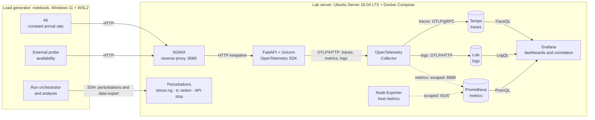

<div align="center">


<sub>Illustrative overview. The implemented telemetry flow is described in <a href="#architecture">Architecture</a>.</sub>

# Observability Engineering Framework

**An open-source observability laboratory for metrics, logs and traces, with controlled workload and perturbation experiments on low-cost hardware.**

</div>

> **Resumo em português** — Repositório do Trabalho de Conclusão de Curso (TCC) do Bacharelado em Engenharia de Computação. O TCC1 (projeto de pesquisa) foi concluído; o TCC2 (implementação e avaliação) está em andamento. O código da aplicação, da stack de observabilidade e dos experimentos já está versionado; a implantação no servidor do laboratório e a execução dos experimentos estão em preparação. Nenhum resultado experimental foi publicado até o momento.

---

## About the project

The Observability Engineering Framework is the final project of an undergraduate degree in Computer Engineering.

Its purpose is to design, implement and evaluate an observability environment built only with open-source technologies and low-cost hardware, and to verify to what extent it provides enough information to **detect, investigate and interpret** changes in the behaviour of an application under normal operation, different load levels and controlled stress conditions.

The observed system is an instrumented FastAPI application published through NGINX. Metrics, logs and traces are produced with OpenTelemetry and handled by the OpenTelemetry Collector, Prometheus, Loki, Tempo and Grafana. All services run with Docker Compose on a single lab server. A separate notebook generates the workload with k6 and measures the service from the outside.

> This repository is under active development. Items marked as *pending* or *planned* are not yet operational, and no experimental results have been published yet.

---

## Current status

*Last updated: 2026-10-16.*

| Area | Status |
|---|---|
| Ubuntu Server 26.04 LTS installed on the lab server | Completed |
| Wi-Fi network, static IP and SSH access | Completed |
| System updates | Completed |
| Dedicated wired network between notebook and server | In progress |
| Docker Engine and Docker Compose on the server | Pending |
| Application, NGINX and observability stack (code and configuration) | Versioned, pending validation on the lab server |
| Grafana data sources and dashboards (provisioned as code) | Versioned, pending validation on the lab server |
| k6 workloads and perturbation scripts | Versioned, pending pilot runs |
| Run orchestration, export and analysis scripts | Versioned, pending pilot runs |
| Pilot runs and protocol freeze | Planned |
| Experimental campaign | Planned |
| Analysis, redeployment test and final documentation | Planned |

---

## Project objectives

### General objective

Develop and validate an open-source observability framework that integrates telemetry, storage and visualization tools to analyse the performance and reliability of a back-end application.

### Specific objectives

- Set up an experimental environment on low-cost hardware running Linux Ubuntu Server LTS.
- Develop a back-end application with FastAPI and instrument it with OpenTelemetry.
- Integrate Prometheus, Grafana, Loki and Tempo to collect, store and analyse telemetry signals.
- Run load tests with k6 and controlled perturbation (chaos engineering) experiments on CPU, memory and network, using stress-ng and tc netem.
- Evaluate the system behaviour against previously defined service-level indicators (SLIs) and objectives (SLOs).

### Validation criteria

The framework is considered validated only if verifiable evidence shows that:

- the application responds correctly under normal conditions;
- OpenTelemetry produces and exports metrics, logs and traces;
- Prometheus, Loki and Tempo receive and allow querying of their respective signals;
- Grafana presents the information from the different back-ends;
- k6 delivers the planned demand without losses and allows latency, throughput and errors to be calculated per scenario;
- the perturbations produce identifiable changes in CPU, memory or network behaviour;
- a single `trace_id` leads from a log entry to the trace of the same request;
- the SLIs can be calculated and compared with the SLO targets;
- the environment can be redeployed from this repository and its documentation.

---

## Architecture



Solid arrows show requests and telemetry pushed by their producer (HTTP and OTLP) and the data Grafana reads from each back-end (PromQL, LogQL, TraceQL); dashed arrows show metrics pulled by Prometheus (scrape). Prometheus does not receive logs or traces. The perturbations act on the host CPU and memory (C4, C5), on the NGINX container network (C6) or on the API container (C7).

Detailed diagrams of the topology, the telemetry pipeline, the life of a request, the run orchestration and the evaluation stages: [`docs/architecture/`](docs/architecture/).

| Endpoint | Service | Access |
|---|---|---|
| `LAB_BIND_IP:8080` | NGINX, the single entry point | Load generator and probe, over the dedicated lab network |
| `127.0.0.1:3000` / `9090` / `3100` / `3200` | Grafana / Prometheus / Loki / Tempo | Server only; from the notebook through an SSH tunnel |
| Host network `:9100` | Node Exporter | Scraped by Prometheus |
| `collector:4318`, `tempo:4317` | OTLP | Internal Compose network only |

---

## Telemetry signals

| Signal | Produced by | Path | Storage and query |
|---|---|---|---|
| Traces | Server span for each request (FastAPI instrumentation) and child spans `validar_entrada` and `calcular_hash` | OTLP/HTTP → Collector → OTLP/gRPC | Tempo, TraceQL |
| Application metrics | `http.server.request.duration` histogram (stable HTTP semantic conventions) | OTLP/HTTP → Collector → Prometheus exporter, scraped every 5 s | Prometheus, PromQL |
| Host metrics | Node Exporter: CPU, memory, disk, network, temperature | Scraped every 5 s | Prometheus, PromQL |
| Pipeline health | Collector internal metrics, Prometheus, Loki and Tempo targets | Scraped every 5 s | Prometheus, PromQL |
| Application logs | Structured `request_completed` event (route, status, duration, `run_id`) carrying `trace_id` and `span_id` | OTLP/HTTP → Collector → Loki OTLP endpoint | Loki, LogQL |
| Proxy logs | NGINX JSON access log (`request_time`, upstream times, `run_id`) | Container output, exported with each run | Run files |

**Correlation.** Every application log carries the `trace_id` of its request; a Grafana derived field opens the corresponding trace in Tempo, and Tempo links back to the logs of the trace. Each run sends an `X-Run-ID` header, recorded as a span attribute and a log attribute, but never as a metric label, to avoid cardinality growth. Traces are sampled at 100%.

**Dashboards** (provisioned from [`config/grafana/dashboards/`](config/grafana/dashboards/)):

1. HTTP service (server view): throughput, P95/P99 latency, 5xx responses, requests by status code.
2. Host resources: CPU, memory, load, network traffic and temperature.
3. Telemetry integrity: scrape targets, items accepted, refused and queued by the Collector.
4. Investigation: application events and traces filtered by `run_id`.

---

## Experimental application

| Route | Behaviour | Use |
|---|---|---|
| `GET /health` | `200 {"status":"ok"}`; excluded from telemetry | Container health check |
| `GET /work?n=20000` | Validates `1 ≤ n ≤ 100000` and applies SHA-256 `n` times to a fixed seed; returns `n` and `digest` | Representative operation for workload, probe and SLIs |
| `GET /controlled-error` | `503` with an error log and an error span, only when `ENABLE_TEST_ROUTES=true` (otherwise `404`) | Correlation proof; disabled during the campaign |

The computation is deterministic: the expected digest is calculated outside the server ([`scripts/expected_digest.py`](scripts/expected_digest.py)), so a request only counts as successful when it returns status 200 **and** the correct content.

---

## SLIs and SLO targets

| SLI | Source | Definition |
|---|---|---|
| Latency P95 and P99 | k6 (client side) | Nearest-rank percentile over correct responses only |
| Composite error rate | k6 | Failed attempts divided by attempts; a failure is a status other than 200, an incorrect body, a timeout or a connection error |
| Successful throughput | k6 | Correct responses per second, compared with the offered rate |
| Sampled availability | External probe | Successful probes divided by probes, evaluated only when probe coverage is 100% |

Targets are recorded in [`experiments/scenarios/protocol-v1.md`](experiments/scenarios/protocol-v1.md) **before** the campaign and are not changed after results are seen:

- composite error rate ≤ 1%;
- sampled availability ≥ 99% in each measurement window;
- successful throughput ≥ 95% of the offered rate;
- P95 and P99 latency derived from the C0 pilot (proposed rule: twice the pilot value, rounded up to a multiple of 25 ms).

CPU and memory utilisation are treated as resource metrics that help explain the results, not as SLOs. Server-side percentiles from Prometheus histograms are estimates; the primary latency source is the client.

These are experimental targets for a laboratory environment, not production guarantees or service-level agreements.

---

## Experimental design

| ID | Scenario | Demand | Perturbation |
|---|---|---|---|
| C0 | Reference (baseline) | R0, about 20–25% of the measured capacity | None |
| C1 | Low load | About 5–10% of capacity | None |
| C2 | Medium load | About 40–50% of capacity | None |
| C3 | High load | About 70–80% of capacity | None |
| C4 | CPU contention | R0 | `stress-ng` on all CPU threads of the host |
| C5 | Memory pressure | R0 | `stress-ng --vm` under a systemd `MemoryMax` ceiling |
| C6 | Network delay | R0 | `tc netem` delay on the NGINX container interface |
| C7 | Controlled API failure (optional) | R0 | API container stopped for 60 s, then restarted |

Capacity is measured first with a stepped ramp ([`experiments/k6/ramp.js`](experiments/k6/ramp.js)). Demands, intensities and targets are calibrated in pilot runs and then frozen. Details: [`experiments/experimental-matrix.md`](experiments/experimental-matrix.md).

Methodological safeguards:

- **Baseline** recorded before the other scenarios.
- **Repetition:** three valid runs per scenario, in three blocks with alternating order.
- **Fixed windows:** 60 s warm-up and 180 s phases; perturbation scenarios have *before*, *during* and *after* phases.
- **Open workload model:** constant arrival rate (requests per second); virtual users are only generator capacity.
- **External measurement:** the load generator and the probe run outside the server, so the measurement survives degradation of the API or of the telemetry.
- **Time synchronisation:** server in UTC with chrony; the clock offset between notebook and server is measured in every run.
- **Reproducibility:** pinned versions, configuration as code, and a protocol frozen with a Git tag before the campaign.
- **Data integrity:** raw data of each run kept with SHA-256 checksums; invalid runs are preserved and marked, never deleted.
- **Pilot runs are never reported as results.**

---

## Experimental environment

| Component | Description |
|---|---|
| Lab server | Low-cost desktop computer, sold commercially as a “Mini PC”: Intel Core i7-2600 (4 cores, 8 threads), B75 board, 16 GB RAM, 480 GB SSD |
| Operating system | Ubuntu Server 26.04 LTS (kernel 7.0), on a dedicated partition (dual boot) |
| Load generator | Notebook with Windows 11 and WSL2 (Ubuntu), running k6, the probe and the analysis |
| Network | Dedicated Ethernet link between notebook and server (`10.10.10.0/24`, no gateway); Wi-Fi only for internet access and updates |

### Pinned versions

| Component | Version | Component | Version |
|---|---|---|---|
| OpenTelemetry Collector (contrib) | 0.162.0 | Python base image | 3.12-slim |
| Prometheus | 3.15.0 | FastAPI / Starlette / Uvicorn | 0.141.1 / 1.6.0 / 0.53.0 |
| Loki | 3.7.8 | OpenTelemetry Python SDK / instrumentation | 1.45.1 / 0.66b1 |
| Tempo | 3.1.0 | k6 | 2.3.0 |
| Grafana | 13.1.3 | Node Exporter | 1.12.1 |
| NGINX | 1.30.5 | | |

Image digests and the full dependency lock (`app/requirements.lock`) are recorded after the first build on the lab server.

Installation evidence: [Ubuntu Server installation notes](docs/lab-notes/ubuntu-server-installation.md).

---

## Getting started

Requirements on the server: Ubuntu Server LTS, Git, Docker Engine and the Docker Compose plugin.

```bash
git clone https://github.com/itamarsb/Observability-Engineering-Framework.git
cd Observability-Engineering-Framework

cp .env.example .env && chmod 600 .env   # set GRAFANA_ADMIN_PASSWORD, APP_VERSION and LAB_BIND_IP
docker compose config -q                 # validates compose.yaml

docker compose build api
docker compose up -d api nginx
docker compose up -d prometheus loki tempo grafana
docker compose up -d collector node-exporter
docker compose ps
```

- Full ordered procedure: [`docs/runbooks/deployment.md`](docs/runbooks/deployment.md).
- Grafana from the notebook: `ssh -N -L 3000:127.0.0.1:3000 <user>@<server>` and open `http://localhost:3000`.
- Stop the stack with `docker compose stop`. **Do not** use `docker compose down -v`, which deletes the telemetry volumes.

Running one scenario from the notebook (WSL2, with k6 2.3.0, Python 3 and key-based SSH access to the server):

```bash
scripts/run_scenario.sh C0 r01 pilot
```

> The procedures above are being validated on the lab server and may be adjusted during the pilot runs.

---

## Repository structure

```text
Observability-Engineering-Framework/
├── app/                     # FastAPI application, OpenTelemetry setup, Dockerfile
├── config/
│   ├── grafana/             # data sources and dashboards provisioned as code
│   ├── loki/
│   ├── nginx/
│   ├── otel-collector/      # normal pipelines and a debug-only configuration
│   ├── prometheus/
│   └── tempo/
├── docs/
│   ├── architecture/        # architecture and workflow diagrams (Mermaid)
│   ├── images/              # banner and installation photos
│   ├── lab-notes/           # installation records
│   ├── runbooks/            # deployment and redeployment procedure
│   └── templates/           # lab log and environment record templates
├── experiments/
│   ├── k6/                  # constant-rate workload and capacity ramp
│   ├── scenarios/           # parameters of C0–C7 and the experimental protocol
│   ├── stress-ng/           # perturbation scripts: CPU, memory, network, API stop
│   └── experimental-matrix.md
├── results/                 # consolidated summaries and evidence index
├── scripts/                 # orchestration, probe, export, analysis and plots
├── tcc/                     # academic documents, after final evaluation
├── compose.yaml
├── .env.example
├── CITATION.cff
└── LICENSE
```

---

## Roadmap

### Completed

- [x] Install Ubuntu Server 26.04 LTS on the lab server.
- [x] Configure network access, static IP and SSH.
- [x] Install operating system updates.
- [x] Create the repository structure and metadata.
- [x] Version the application, the Compose stack, the configuration, the workloads and the analysis scripts.
- [x] Align the documentation with the Docker Compose design.

### Implementation and evaluation stages

- [ ] **Stage 0** — Access check, server and notebook inventory, backup.
- [ ] **Stage 1** — Dedicated wired network, UTC clock with chrony, Docker Engine and Compose.
- [ ] **Stage 2** — Same commit on the server and on the load generator; local `.env`.
- [ ] **Stage 3** — API behind NGINX; functional tests; dependency lock.
- [ ] **Stage 4A** — Instrumentation verified with the Collector debug exporter.
- [ ] **Stage 4B** — Prometheus, Loki, Tempo and Grafana integrated; log-to-trace correlation proof.
- [ ] **Stage 5** — Dashboards, queries and data export checked.
- [ ] **Stage 6** — Pilot runs: capacity ramp, load calibration, targets, perturbation safety limits.
- [ ] **Stage 7** — Freeze protocol v1 (commit and tag `protocolo-v1`).
- [ ] **Stage 8** — Campaign: scenarios C0–C6 (and C7, if kept), three repetitions each.
- [ ] **Stage 9** — Analysis: SLIs versus SLOs, tables, figures and investigation.
- [ ] **Stage 10** — Redeployment from the repository as a reproducibility check.
- [ ] **Stage 11** — Evidence index, final figures and release tag.

---

## Results

No experimental results have been published yet. See [`results/README.md`](results/README.md) for how run data, summaries and evidence are organised.

---

## Known limitations

- Single-node environment; it does not represent a distributed corporate infrastructure.
- The lab server runs in dual boot, and the load generator is a notebook running WSL2.
- Telemetry collection consumes resources of the observed system.
- FastAPI is pinned to a release prior to its native OpenTelemetry support, to keep the instrumentation design stable during the project.
- Reproducibility is verified on the same hardware.

---

## Security notes

- Only NGINX is published on the lab network; administrative interfaces are bound to `127.0.0.1` and reached through an SSH tunnel.
- `.env`, keys, raw run data and telemetry volumes are excluded from version control.
- Logs and span attributes do not carry personal or sensitive data.

---

## Academic context

This repository supports an undergraduate final project (TCC) in Computer Engineering, developed in two stages: TCC1 (research proposal, completed) and TCC2 (implementation and evaluation, in progress).

The source code, configuration files, experimental procedures and documentation are maintained here to support technical review, reproducibility, portfolio presentation and future research. The academic texts will be added to [`tcc/`](tcc/) after their final evaluation.

If this project is used in academic or technical work, consult the citation metadata in [`CITATION.cff`](CITATION.cff).

---

## License

This project is licensed under the [MIT License](LICENSE).

Copyright © 2026 Itamar de Sá Britto Júnior.


---


## 📈 Repository Metrics

<p align="center">
    
<a href="https://info.flagcounter.com/A1ey"></a>

</p>
