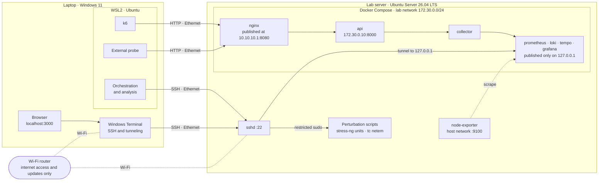
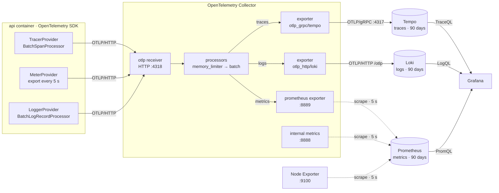
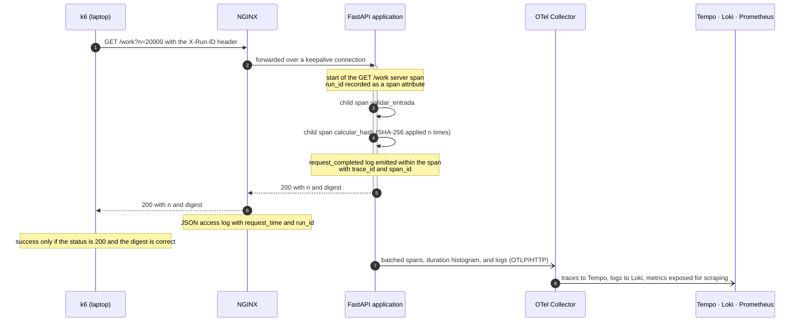
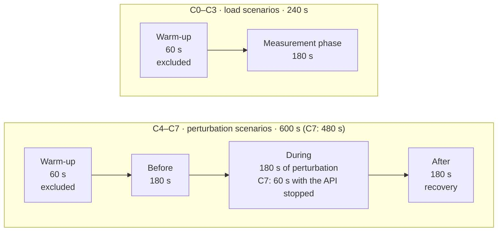
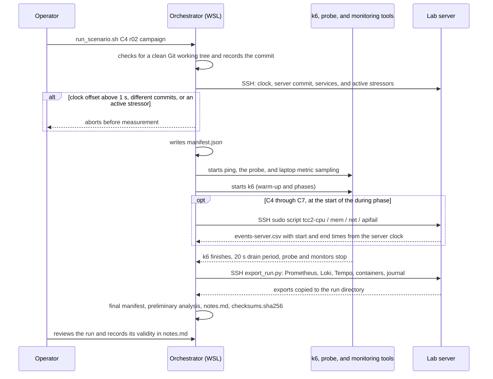
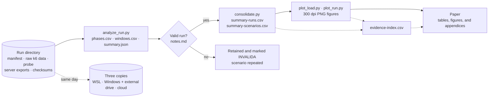

# Architecture and Workflows

**Language:** [Português (Brasil)](README.md) | **English (US)**

Framework diagrams written in [Mermaid](https://mermaid.js.org/) and rendered directly by GitHub. They describe the planned design and will be updated to reflect the actual deployed configuration after the integration stage (Stage 4B).

The overall diagram is available in the main [README](../../README.en.md#architecture).

| # | Diagram | What it shows |
|---|---|---|
| 1 | [Lab topology](#1-lab-topology) | Machines, networks, containers, and published ports |
| 2 | [Telemetry pipeline](#2-telemetry-pipeline) | How traces, metrics, and logs travel from the application to the backends |
| 3 | [Request flow](#3-request-flow) | A `GET /work` request and the telemetry it generates |
| 4 | [Run phases](#4-run-phases) | Time windows for load and perturbation scenarios |
| 5 | [Run orchestration](#5-run-orchestration) | What the orchestrator does, from initial checks to checksums |
| 6 | [Data and evidence flow](#6-data-and-evidence-flow) | From raw run data to tables, figures, and the paper |
| 7 | [Implementation and evaluation stages](#7-implementation-and-evaluation-stages) | Stages 0 through 11 and the protocol freeze |

---

## 1. Lab topology

The laptop and server are connected by a dedicated Ethernet cable (`10.10.10.2` ↔ `10.10.10.1`, with no gateway), which carries the workload, probe traffic, and SSH traffic. Wi-Fi is used only for internet access and updates so that its latency variations do not affect measurements. NGINX is the only application port intentionally published on the dedicated network.

Node Exporter uses `network_mode: host`, and port 9100 requires verification of listening interfaces and firewall rules; administrative interfaces are accessible through the SSH tunnel.

---

## 2. Telemetry pipeline

Traces and logs are **sent** by the Collector to Tempo and Loki; metrics are exposed by the Collector and **scraped** by Prometheus. In Grafana, the `trace_id` in each log opens the corresponding trace in Tempo, and each trace links back to its logs.

---

## 3. Request flow

The same `trace_id` appears in the request trace (Tempo) and log (Loki), making correlation verifiable. The `run_id` links both to the run directory; it is never used as a metric label.

---

## 4. Run phases

Requests are assigned to phases according to their completion timestamps. In scenarios C4–C7, the start and end of the perturbation are recorded by the server itself and aligned with client data using the clock offset measured during the run. Recovery is reached at the first 30 s window with P95 ≤ 1.2 × the P95 of the *before* phase and no failures, sustained for 60 s.

---

## 5. Run orchestration

Each run produces a self-contained directory, `runs/<pilot|campaign>/<scenario>-<repetition>-<UTC timestamp>/`. An interrupted run or one classified as invalid is retained and marked, never deleted.

---

## 6. Data and evidence flow

Every number in the paper must be traceable to a file: the evidence index records the source file, the script or query that produced it, and where it is used.

---

## 7. Implementation and evaluation stages

```mermaid
flowchart LR
    subgraph PREP["Preparation"]
        direction TB
        S0["Stage 0<br/>access, inventory, and backup"] --> S1["Stage 1<br/>wired network, UTC clock, and Docker"] --> S2["Stage 2<br/>same commit on both machines"]
    end

    subgraph BUILD["Build and integration"]
        direction TB
        S3["Stage 3<br/>API behind NGINX and functional tests"] --> S4A["Stage 4A<br/>instrumentation verified with the debug exporter"] --> S4B["Stage 4B<br/>backends and log-to-trace correlation proof"] --> S5["Stage 5<br/>dashboards, queries, and exports"]
    end

    subgraph CAL["Calibration"]
        direction TB
        S6["Stage 6<br/>pilots: capacity ramp, workloads,<br/>targets, and perturbations"] --> S7{{"Stage 7<br/>protocol v1 frozen<br/>commit and tag"}}
    end

    subgraph MEAS["Measurement and analysis"]
        direction TB
        S8["Stage 8<br/>campaign: C0 and C2–C6 (+C7)<br/>3 blocks, 3 repetitions"] --> S9["Stage 9<br/>analysis: SLIs vs. SLOs"] --> S10["Stage 10<br/>evidence index and final figures"]
    end

    S2 --> S3
    S5 --> S6
    S7 --> S8
    S7 -.->|"change requested"| V2["Protocol v2<br/>reason documented"]
    V2 -.->|"repeat affected scenarios"| S8
```

A stage begins only after the previous one meets its exit criterion, as recorded in the lab logbook. Targets, workloads, and time windows are frozen before the campaign; any subsequent change results in a new protocol version rather than modifying the previous one.

---

[Return to the documentation index](../README.en.md)
