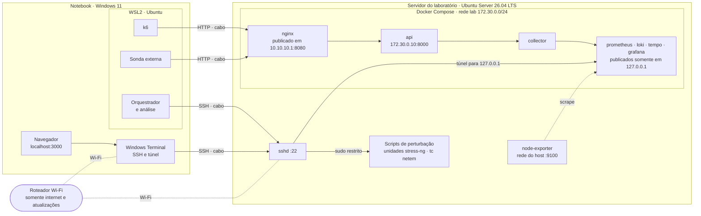
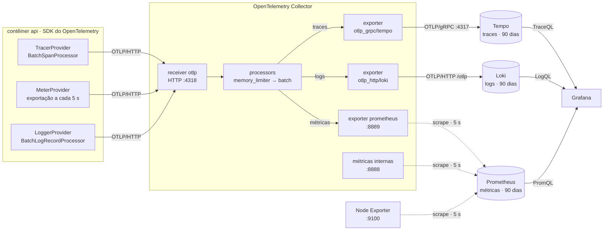
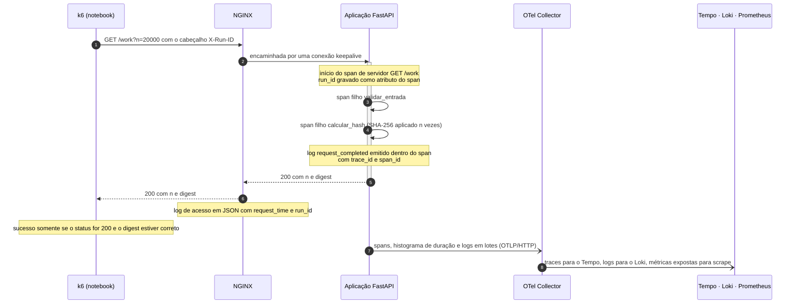
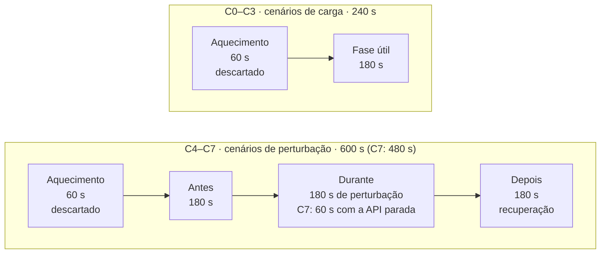
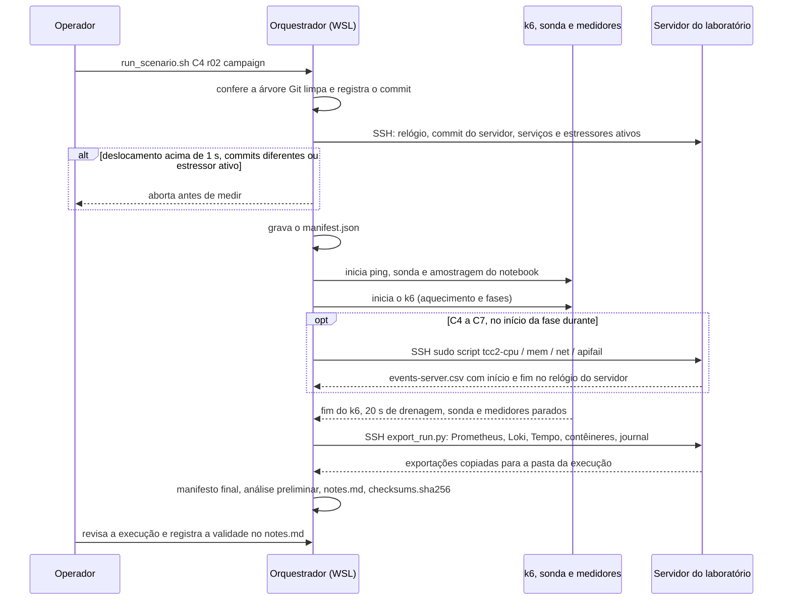
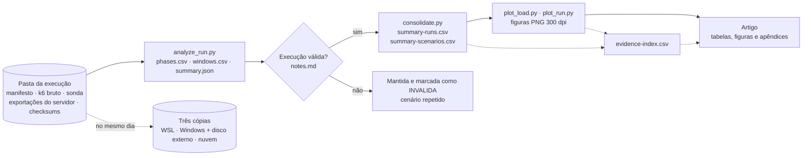

# Arquitetura e fluxos de trabalho

Diagramas do framework, escritos em [Mermaid](https://mermaid.js.org/) e renderizados diretamente pelo GitHub. Eles descrevem o desenho planejado e serão atualizados para a configuração efetivamente implantada após a etapa de integração (Etapa 4B).

O diagrama geral está no [README](../../README.md#arquitetura) principal.

| # | Diagrama | O que mostra |
|---|---|---|
| 1 | [Topologia do laboratório](#1-topologia-do-laboratório) | Máquinas, redes, contêineres e portas publicadas |
| 2 | [Pipeline de telemetria](#2-pipeline-de-telemetria) | Como traces, métricas e logs vão da aplicação até os back-ends |
| 3 | [Percurso de uma requisição](#3-percurso-de-uma-requisição) | Uma requisição `GET /work` e a telemetria que ela produz |
| 4 | [Fases de uma execução](#4-fases-de-uma-execução) | Janelas de tempo dos cenários de carga e de perturbação |
| 5 | [Orquestração de uma execução](#5-orquestração-de-uma-execução) | O que o orquestrador faz, das verificações iniciais às somas de verificação |
| 6 | [Fluxo de dados e evidências](#6-fluxo-de-dados-e-evidências) | Dos dados brutos de cada execução às tabelas, figuras e ao artigo |
| 7 | [Etapas de implementação e avaliação](#7-etapas-de-implementação-e-avaliação) | Etapas 0 a 11 e o congelamento do protocolo |

---

## 1. Topologia do laboratório

O notebook e o servidor são ligados por um cabo Ethernet dedicado (`10.10.10.2` ↔ `10.10.10.1`, sem gateway), que transporta a carga, a sonda e o SSH. O Wi-Fi é usado apenas para acesso à internet e atualizações, de modo que a sua variação de latência não afeta as medições. O NGINX e a unica porta de aplicacao publicada intencionalmente na rede dedicada.
O Node Exporter usa `network_mode: host` e a porta 9100 exige verificacao de escuta e firewall;
as interfaces administrativas sao acessiveis pelo tunel SSH.

---

## 2. Pipeline de telemetria

Traces e logs são **enviados** pelo Collector ao Tempo e ao Loki; as métricas são expostas pelo Collector e **coletadas** pelo Prometheus (*scrape*). No Grafana, o `trace_id` presente em cada log abre o trace correspondente no Tempo, e cada trace leva de volta aos seus logs.

---

## 3. Percurso de uma requisição

O mesmo `trace_id` aparece no trace (Tempo) e no log (Loki) da requisição, e é isso que torna a correlação verificável. O `run_id` liga ambos à pasta da execução; ele nunca é usado como rótulo de métrica.

---

## 4. Fases de uma execução

As requisições são atribuídas às fases pelo horário de conclusão. Nos cenários C4–C7, o início e o fim da perturbação são registrados pelo próprio servidor e alinhados aos dados do cliente com o deslocamento de relógio medido na execução. A recuperação é atingida na primeira janela de 30 s com P95 ≤ 1,2 × o P95 da fase *antes* e sem falhas, mantida por 60 s.

---

## 5. Orquestração de uma execução

Cada execução produz uma pasta autocontida, `runs/<pilot|campaign>/<cenário>-<repetição>-<horário UTC>/`. Uma execução interrompida ou classificada como inválida é mantida e marcada, nunca apagada.

---

## 6. Fluxo de dados e evidências

Todo número do artigo deve ser rastreável até um arquivo: o índice de evidências registra o arquivo de origem, o script ou a consulta que o produziu e onde ele é utilizado.

---

## 7. Etapas de implementação e avaliação

```mermaid
flowchart LR
    subgraph PREP["Preparação"]
        direction TB
        S0["Etapa 0<br/>acesso, inventário e backup"] --> S1["Etapa 1<br/>rede cabeada, relógio UTC e Docker"] --> S2["Etapa 2<br/>mesmo commit nas duas máquinas"]
    end

    subgraph BUILD["Construção e integração"]
        direction TB
        S3["Etapa 3<br/>API atrás do NGINX e testes funcionais"] --> S4A["Etapa 4A<br/>instrumentação comprovada com o exporter de depuração"] --> S4B["Etapa 4B<br/>back-ends e prova de correlação log-trace"] --> S5["Etapa 5<br/>painéis, consultas e exportação"]
    end

    subgraph CAL["Calibração"]
        direction TB
        S6["Etapa 6<br/>pilotos: rampa de capacidade, cargas,<br/>metas e perturbações"] --> S7{{"Etapa 7<br/>protocolo v1 congelado<br/>commit e tag"}}
    end

    subgraph MEAS["Medição e análise"]
        direction TB
        S8["Etapa 8<br/>campanha: C0–C6 (+C7)<br/>3 blocos, 3 repetições"] --> S9["Etapa 9<br/>análise: SLIs × SLOs"] --> S10["Etapa 10<br/>reimplantação a partir do repositório"] --> S11["Etapa 11<br/>índice de evidências e figuras finais"]
    end

    S2 --> S3
    S5 --> S6
    S7 --> S8
    S7 -.->|"mudança solicitada"| V2["Protocolo v2<br/>motivo registrado"]
    V2 -.->|"repetir os cenários afetados"| S8
```

Uma etapa só começa depois que a anterior cumpre o seu critério de saída, registrado no diário de bordo. Metas, cargas e janelas são congeladas antes da campanha; qualquer mudança posterior gera uma nova versão do protocolo, em vez de alterar a anterior.
