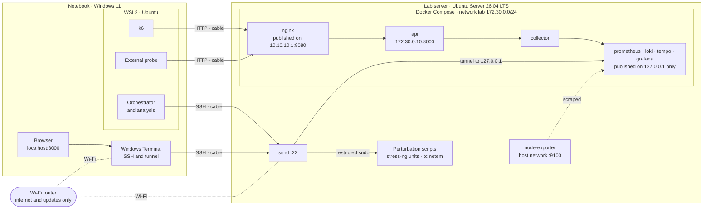
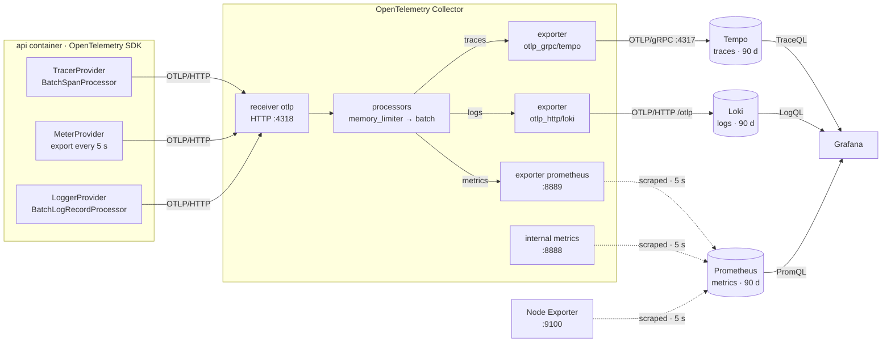
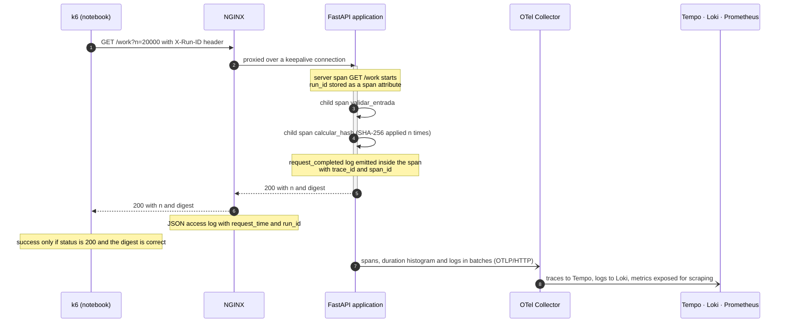
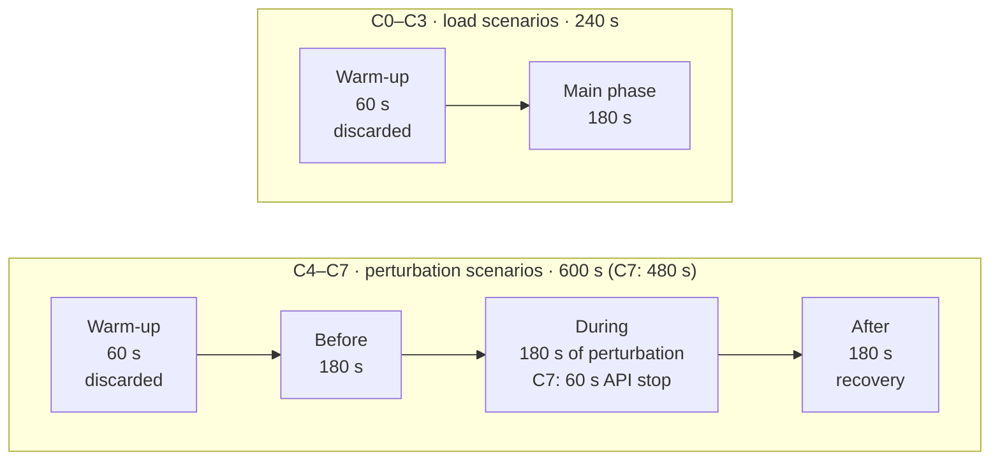
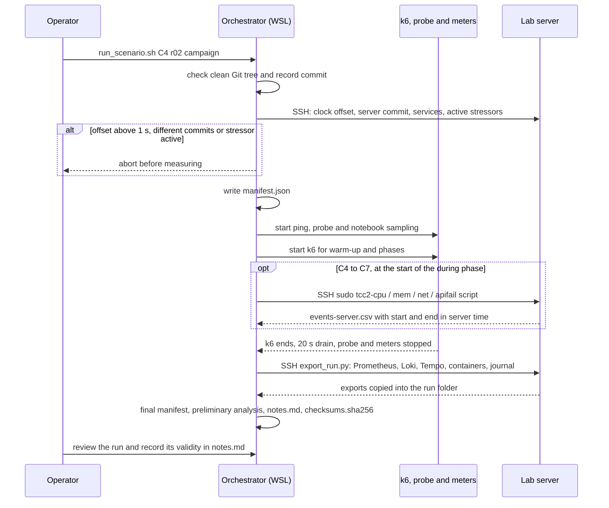
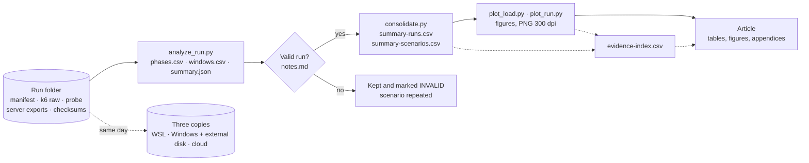

# Architecture and workflows

Diagrams of the framework, written in [Mermaid](https://mermaid.js.org/) and rendered directly by GitHub. They describe the planned design and will be updated to the configuration actually deployed after the integration stage (Stage 4B).

The overview diagram is in the main [README](../../README.md#architecture).

| # | Diagram | What it shows |
|---|---|---|
| 1 | [Lab topology](#1-lab-topology) | Machines, networks, containers and published ports |
| 2 | [Telemetry pipeline](#2-telemetry-pipeline) | How traces, metrics and logs travel from the application to the back-ends |
| 3 | [Life of a request](#3-life-of-a-request) | One `GET /work` request and the telemetry it produces |
| 4 | [Phases of a run](#4-phases-of-a-run) | Time windows of load and perturbation scenarios |
| 5 | [Orchestration of a run](#5-orchestration-of-a-run) | What the orchestrator does from the pre-checks to the checksums |
| 6 | [Data and evidence flow](#6-data-and-evidence-flow) | From raw run data to tables, figures and the article |
| 7 | [Implementation and evaluation stages](#7-implementation-and-evaluation-stages) | Stages 0 to 11 and the protocol freeze |

---

## 1. Lab topology

The notebook and the server are linked by a dedicated Ethernet cable (`10.10.10.2` ↔ `10.10.10.1`, no gateway), which carries the workload, the probe and SSH. Wi-Fi is used only for internet access and updates, so its latency variation does not affect the measurements. Only NGINX is published on the lab network; the administrative interfaces are reachable only through the SSH tunnel.

---

## 2. Telemetry pipeline

Traces and logs are **pushed** by the Collector to Tempo and Loki; metrics are exposed by the Collector and **pulled** by Prometheus. In Grafana, the `trace_id` carried by each log opens the matching trace in Tempo, and each trace links back to its logs.

---

## 3. Life of a request

The same `trace_id` appears in the trace (Tempo) and in the log (Loki) of the request, which is what makes the correlation verifiable. The `run_id` links both to the run folder; it is never used as a metric label.

---

## 4. Phases of a run

Requests are assigned to phases by completion time. For C4–C7, the perturbation start and end are recorded by the server and aligned with the client data using the clock offset measured in the run. Recovery is reached at the first 30 s window with P95 ≤ 1.2 × the *before* P95 and no failures, sustained for 60 s.

---

## 5. Orchestration of a run

Each run produces one self-contained folder, `runs/<pilot|campaign>/<scenario>-<repetition>-<UTC timestamp>/`. A run interrupted or classified as invalid is kept and marked, never deleted.

---

## 6. Data and evidence flow

Every number in the article must be traceable to a file: the evidence index records the source file, the script or query that produced it, and where it is used.

---

## 7. Implementation and evaluation stages

```mermaid
flowchart LR
    subgraph PREP["Preparation"]
        direction TB
        S0["Stage 0<br/>access, inventory, backup"] --> S1["Stage 1<br/>wired network, UTC clock, Docker"] --> S2["Stage 2<br/>same commit on both machines"]
    end

    subgraph BUILD["Build and integration"]
        direction TB
        S3["Stage 3<br/>API behind NGINX, functional tests"] --> S4A["Stage 4A<br/>instrumentation proven with debug exporter"] --> S4B["Stage 4B<br/>back-ends and log-to-trace proof"] --> S5["Stage 5<br/>dashboards, queries, export"]
    end

    subgraph CAL["Calibration"]
        direction TB
        S6["Stage 6<br/>pilots: capacity ramp, loads,<br/>targets, perturbations"] --> S7{{"Stage 7<br/>protocol v1 frozen<br/>commit and tag"}}
    end

    subgraph MEAS["Measurement and analysis"]
        direction TB
        S8["Stage 8<br/>campaign: C0–C6 (+C7)<br/>3 blocks, 3 repetitions"] --> S9["Stage 9<br/>analysis: SLIs vs SLOs"] --> S10["Stage 10<br/>redeployment from the repository"] --> S11["Stage 11<br/>evidence index, final figures"]
    end

    S2 --> S3
    S5 --> S6
    S7 --> S8
    S7 -.->|"change requested"| V2["Protocol v2<br/>reason recorded"]
    V2 -.->|"repeat affected scenarios"| S8
```

A stage starts only after the previous one meets its exit criterion, recorded in the lab log. Targets, loads and windows are frozen before the campaign; any later change creates a new protocol version instead of editing the previous one.
