# Instalação do Ubuntu Server

**Idioma:** [English (US)](ubuntu-server-installation.md) | **Português (Brasil)**

## Objetivo

Preparar o ambiente de laboratório para o Observability Engineering Framework.

## Configuração do laboratório com Ubuntu Server

## Ambiente

- Ubuntu Server 26.04 LTS
- Intel i7-2600
- 16 GB de RAM
- SSD de 480 GB
- Adaptador Wi-Fi USB Realtek RTL8188FTV

## Sistema operacional

Ubuntu Server LTS

## Serviços planejados

- NGINX
- FastAPI
- OpenTelemetry Collector
- Prometheus
- Grafana
- Loki
- Tempo

## Situação

- [X] Ubuntu instalado
- [X] IP estático configurado
- [X] SSH habilitado
- [X] Atualizações instaladas


# Evidências do laboratório

## Hardware do laboratório

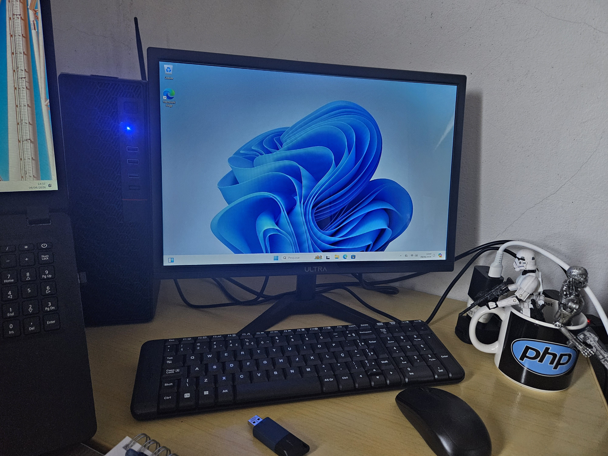

## Seleção da distribuição

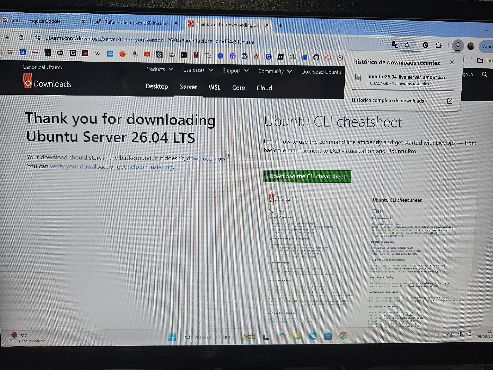

## Particionamento

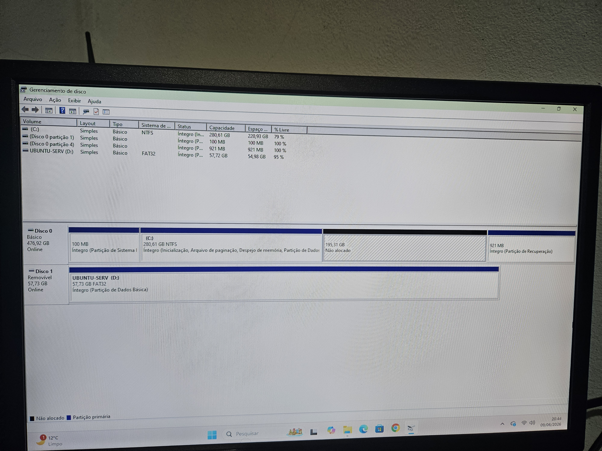

## Instalação do Ubuntu Server

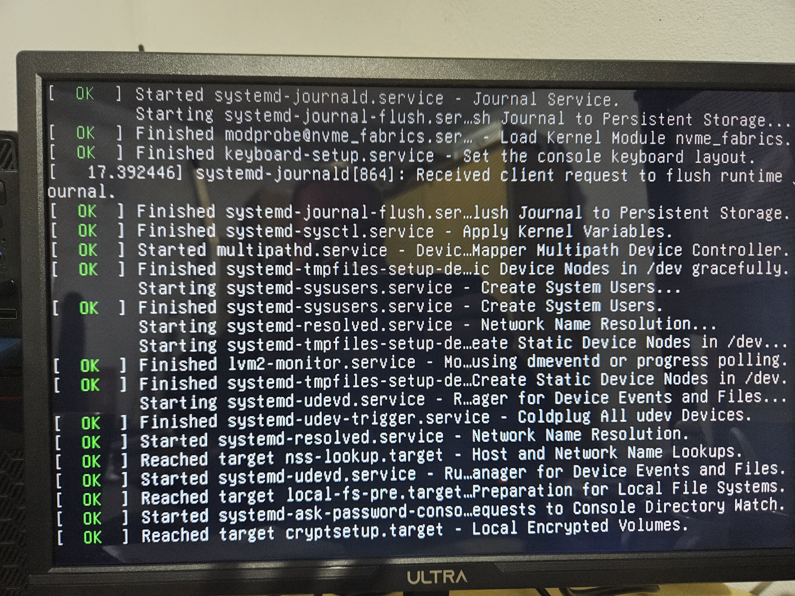

## Primeiro login

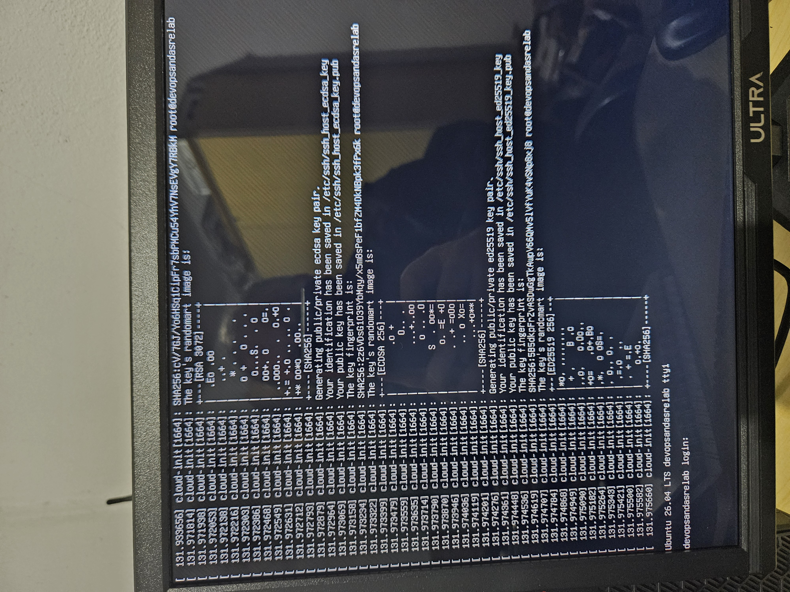

## Finalização

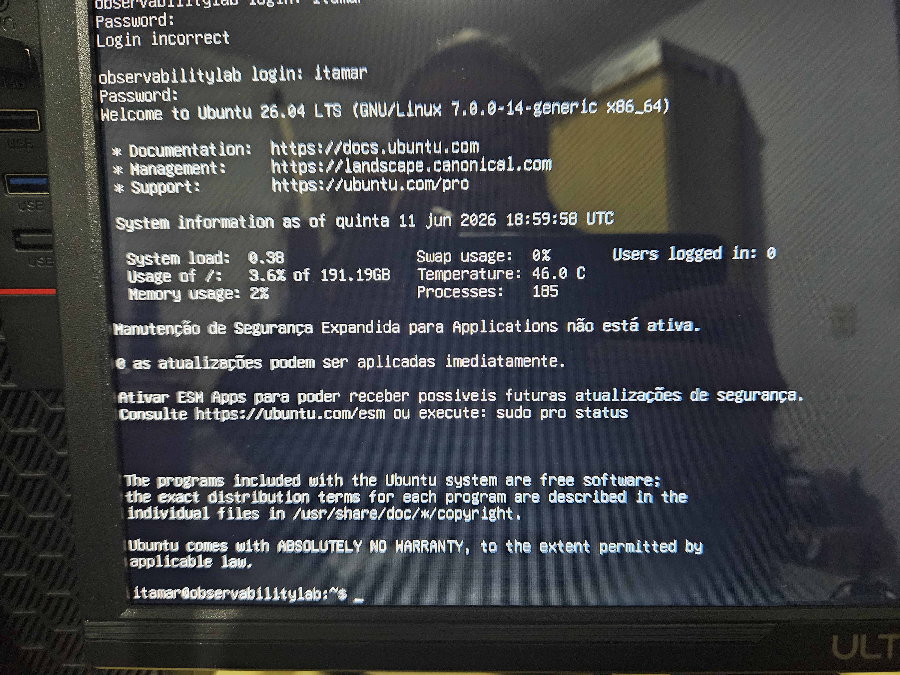

## Diagnóstico de problemas de rede

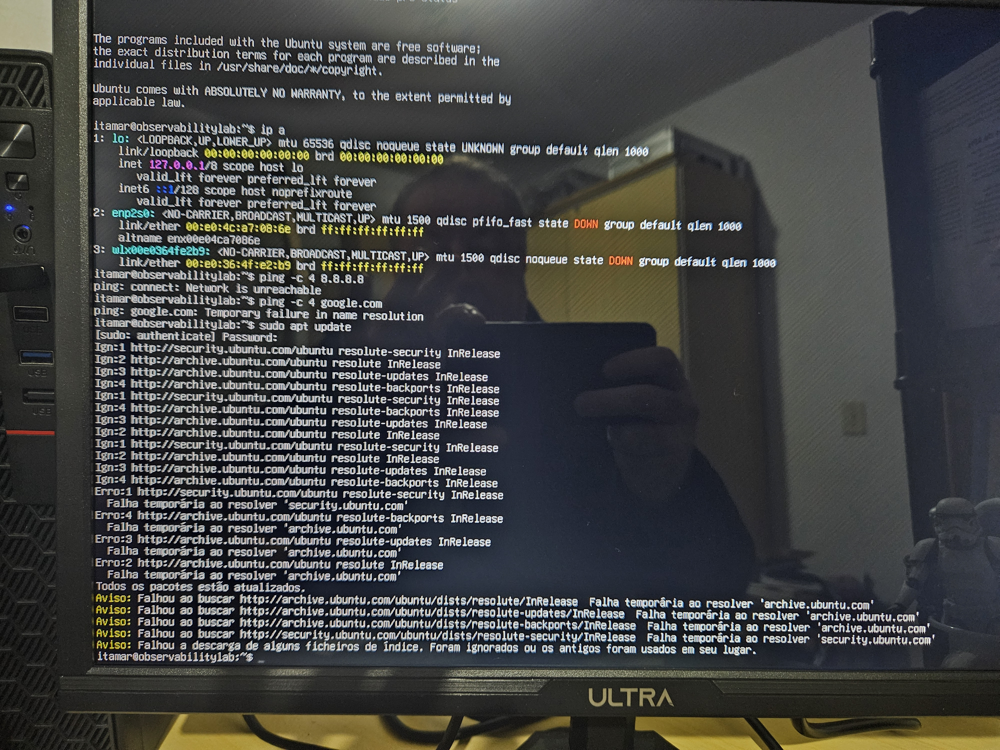

## Verificação do acesso à internet

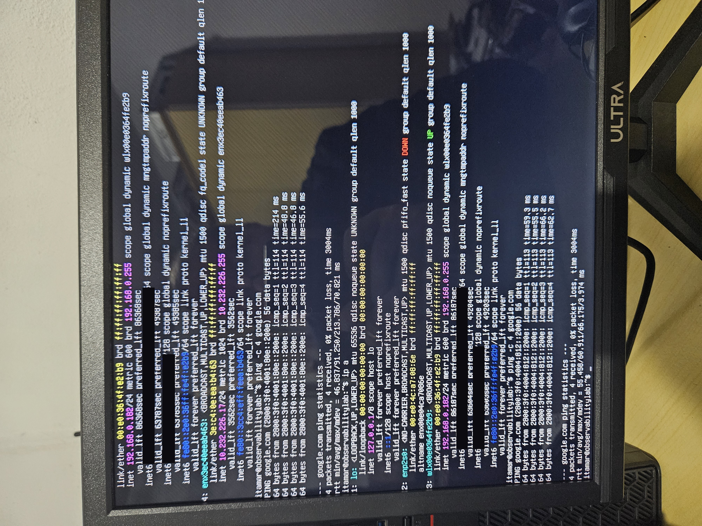

## Validação

```bash
ping google.com
```

## Resultado:

- 0% de perda de pacotes
- Resolução de DNS bem-sucedida
- Conectividade com a internet confirmada

## Atualizações instaladas

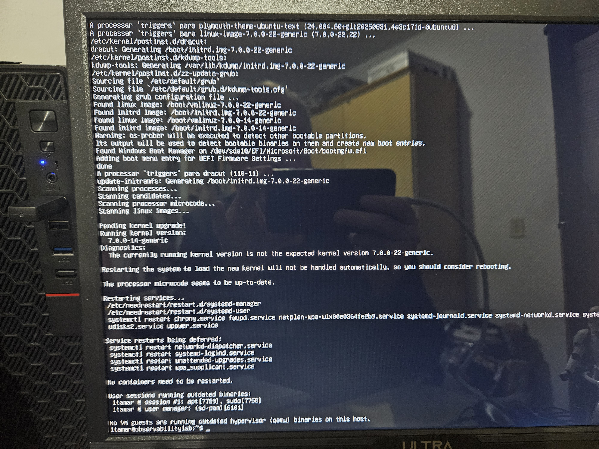

## Atualização completa do sistema:

```bash
sudo apt update
sudo apt upgrade -y
```

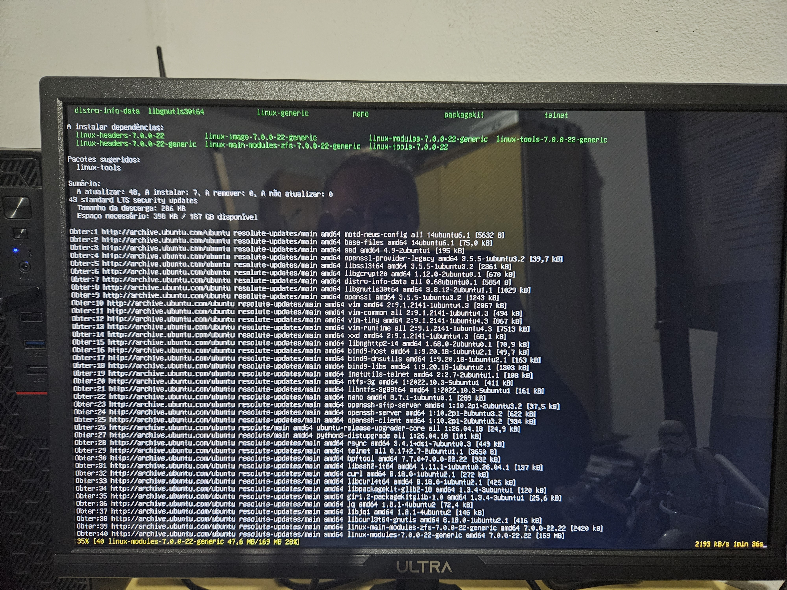

## Em seguida:

```bash
sudo reboot
```

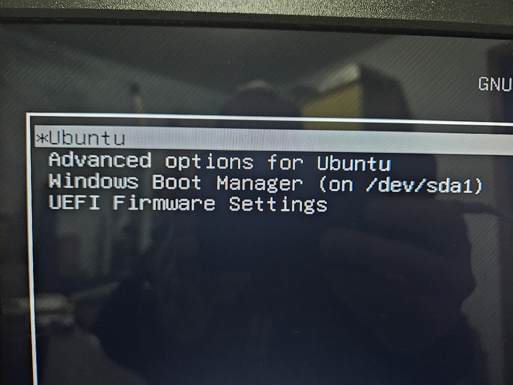

## Após a reinicialização:

```bash
uname -a
```

## E:

```bash
hostnamectl
```

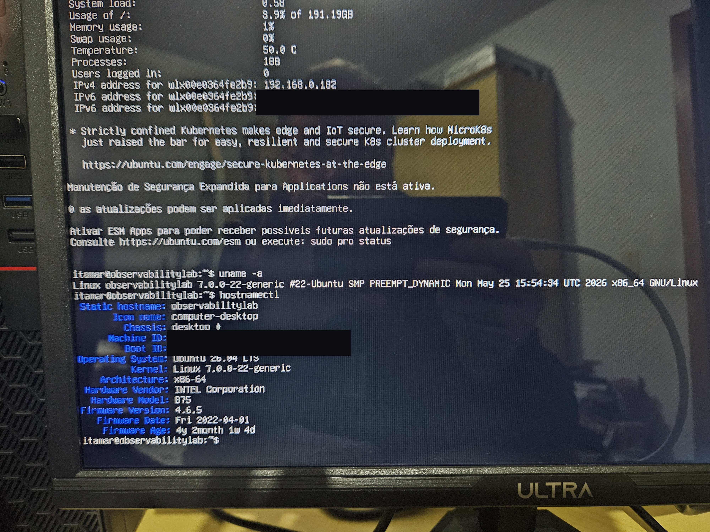

---

[Retornar ao índice da documentação](../README.md)
